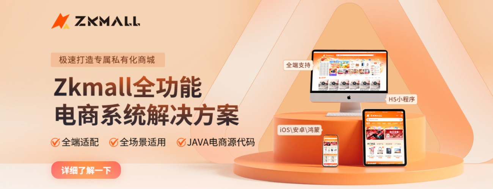

# ZKMALL-B2B2C多商户Java商城后台
<a href="https://mallzk.com" target="_blank"></a>

#### 介绍
**ZKMall** 是一款基于当前流行技术组合 **SpringBoot3 + MybatisPlus + Shiro + JWT + XXL-Job + Redisson + Redis + Mysql + Vue3 + UniApp** **前后端分离 B2B2C多商户 Java电商系统**。系统功能全面，包含**商城、SKU、运费模板、素材库、小程序直播、拼团、砍价、商户管理、秒杀、优惠券、积分、分销、会员、充值、多门店**等丰富模块。
ZKMall 致力于为企业打造一个功能完整、易于维护且马上可以投入经营的 B2B2C JAVA商城系统模板,开箱即用。

#### 同系列开源项目：StackRivet

如果你正在构建非电商类的企业后台、SaaS 系统、管理平台或 AI 原生 Java 应用，可以关注 **StackRivet**：

- **StackRivet-Server**：开源 AI 原生 Java / Spring Boot 企业应用后端，内置 RBAC、代码生成、OpenAPI、审计、资产存储和异步任务。  
  https://gitee.com/zkmall/stackrivet-server
- **StackRivet-Admin-UI**：开源 Vue3 企业后台管理前端，基于 Vite、TypeScript、Element Plus，配套 Java 后端快速构建企业中后台。  
  https://gitee.com/zkmall/stackrivet-admin-ui


后台管理系统包含：
* **平台管理:** 系统设置、权限管理、数据统计等。
* **店铺管理:** 店铺入驻、店铺信息管理、店铺装修等。
* **商品管理:** 商品发布、编辑、分类、规格、库存管理等。
* **订单管理:** 订单创建、支付、发货、售后管理等。
* **规格管理:** 商品规格、属性管理。
* **权限管理:** 完善的角色和权限控制。
* **营销中心:** 拼团、砍价、秒杀、优惠券、积分、分销等多种营销工具。
* **会员管理:** 会员等级、积分管理、充值管理等。
* **物流管理:** 运费模板管理。
* **内容管理:** 素材库、文章管理等。
* **直播管理:** 小程序直播功能。
* **门店管理:** 多门店管理功能。

## 演示地址
* **PC体验访问链接:** [https://shop.mallzk.com](https://shop.mallzk.com)
* **H5体验访问链接:** [https://shop.mallzk.com/h5](https://shop.mallzk.com/h5)
手机号注册即可

* ZKMall 开源技术 QQ 群：Sql脚本及详细文档进群获取**984772612**

## 📸 运行相关截图
### 用户PC端


### 用户移动端


## 🛡️ 授权许可
除开源版本外，ZKMall 还提供商业版本的商城，欲知详情，请访问[商城官网查看](https://mallzk.com/price.html)。

本商城使用 **AGPLv3** 开源协议，请务必遵守 AGPLv3 的相关条款，或者联系作者获取商业授权：[https://mallzk.com](https://mallzk.com)

## 🔗 项目链接
* **JAVA 后台:** [https://gitee.com/zkmall/b2b2c](https://gitee.com/zkmall/b2b2c)
* **平台端 (Admin):** [https://gitee.com/zkmall/b2b2c-admin](https://gitee.com/zkmall/b2b2c-admin)
* **商家端 (Merchant):** [https://gitee.com/zkmall/b2b2c-merchant](https://gitee.com/zkmall/b2b2c-merchant)
* **uni-app (H5/小程序):** [https://gitee.com/zkmall/b2b2c-uniapp](https://gitee.com/zkmall/b2b2c-uniapp)

* **StackRivet 开源 AI 原生 Java 企业应用基座:** [https://gitee.com/zkmall](https://gitee.com/zkmall)
* **StackRivet-Server Java / Spring Boot 后端:** [https://gitee.com/zkmall/stackrivet-server](https://gitee.com/zkmall/stackrivet-server)
* **StackRivet-Admin-UI Vue3 管理端:** [https://gitee.com/zkmall/stackrivet-admin-ui](https://gitee.com/zkmall/stackrivet-admin-ui)

## 🛠️ 部署教程
* **部署文档在这里:** https://gitee.com/zkmall/b2b2c/tree/master/doc

### 📦 目录结构
```
├── zkmall-admin         		# 平台服务管理  
│   ├── src    
│   │	├── main  
│   │	│	├── assembly  		# 打包配置（如 Docker、Maven 插件配置）
│   │	│	├── java   	 		# 业务代码（Controller、Service、Mapper 等）
│   │	│	├── resources  		# 资源文件
│   │	│	│	├── mybatis 	# MyBatis 映射文件（SQL 语句）
│   │	│	│	├── service  	# 服务配置（非标准目录，可能存放服务相关属性）
│   │	│	│	├── static  	# 静态资源（如 Swagger 文档、前端模板）
│   │	│	│	├── application.yml 				# 主配置文件
│   │	│	│	├── application-admin-local.yml		# 环境配置
│   │	│	│	├── application-admin-open.yml 		# 环境配置
│   │	│	│	├── application-security.yml 		# 安全配置（权限、认证等）
│   │	│	│	├── generator.properties
├── zkmall-app           		# H5服务管理      
│   ├── ...同上    
├── zkmall-business      		# 商家服务管理       
│   ├── ...同上      
├── zkmall-commons       		# 公共工具模块
├── zkmall-starter             
│   ├── zkmall-jackson-starter  # Jackson 序列化配置                
│   ├── zkmall-jwt-starter      #  JWT 认证功能配置           
│   ├── zkmall-mybatis-starter  # MyBatis 配置          
│   ├── zkmall-oss-starter      # 对象存储服务             
│   ├── zkmall-redis-starter    # Redis 缓存配置                
│   ├── zkmall-sms-starter    	# 集成短信服务                
│   ├── zkmall-swagger-starter  # Swagger 文档配置                 
│   ├── zkmall-web-starter      # Web 层通用配置        
│   ├── zkmall-xxljob-starter   # XXL-Job 分布式任务配置                    
```

### 💬 提交反馈

- ZKMall 官网: https://mallzk.com
- 商业版源码购买，请联系商务微信。
-    
- SpringBoot3 版本商城，请点击 https://gitee.com/zkmall/b2b2c 查看主项目。
- 更多内容请查看主项目：https://gitee.com/zkmall/

感谢您的关注和使用 ZKMall！如有任何问题或建议，欢迎交流。

## 感谢Star，Fork,我们会时刻更新~

#### 参与贡献
1.  Star Fork 本仓库
2.  新建 Feat_xxx 分支
3.  提交代码
4.  新建 Pull Request

## 更多信息请查看官网 [https://mallzk.com](https://mallzk.com)
