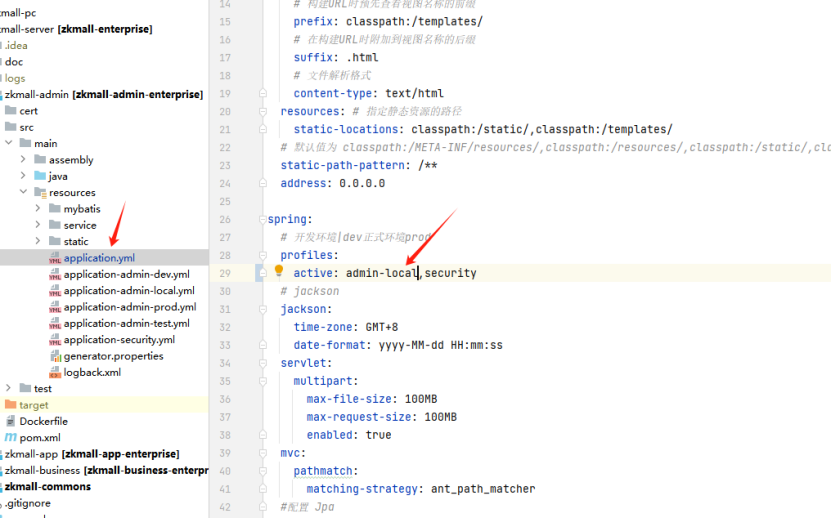
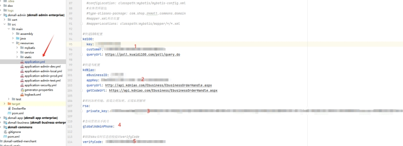
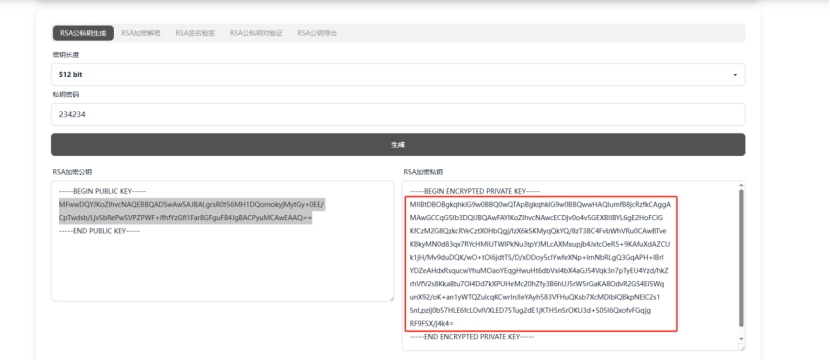
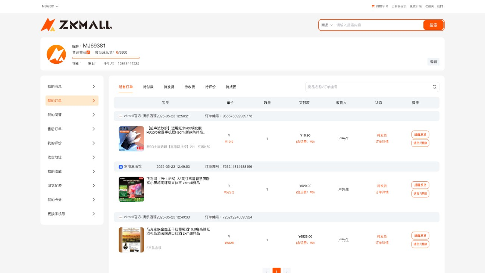
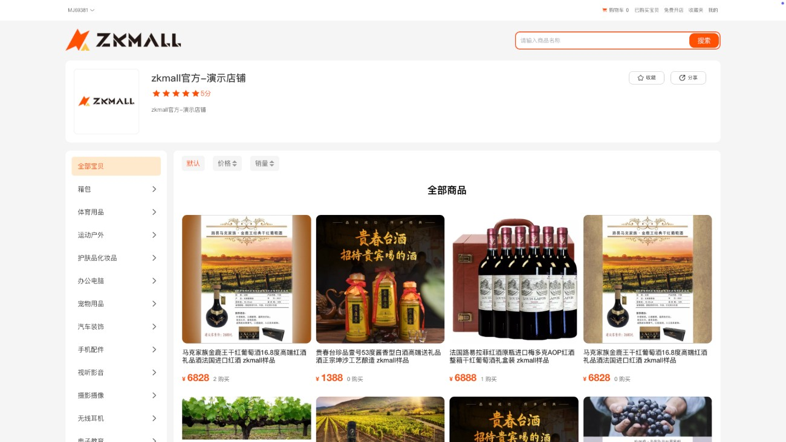
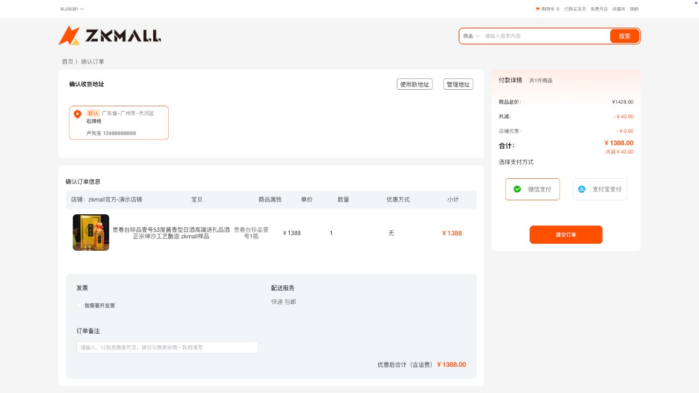
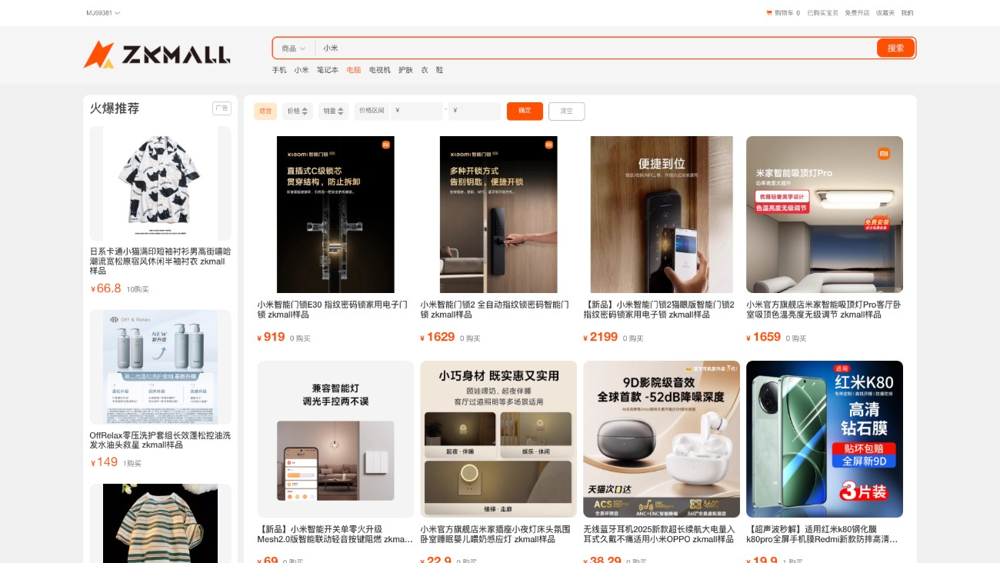
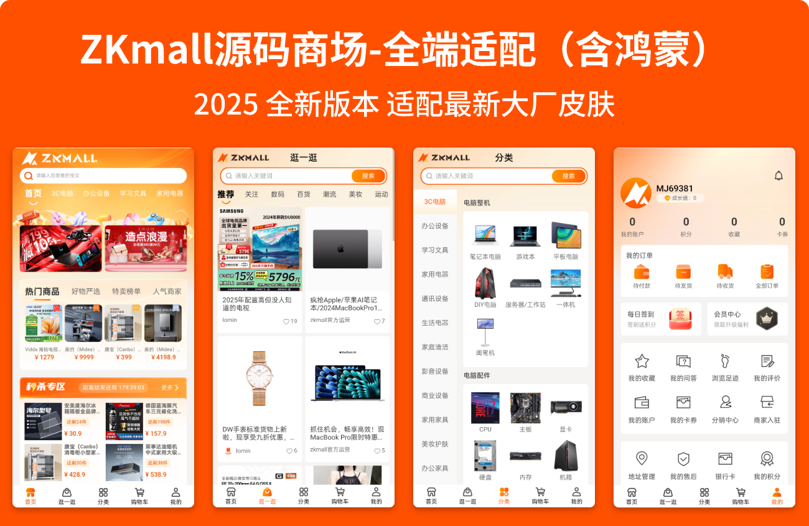

# ZKMALL-B2B2C多商户Java商城后台部署文档

## 官网演示地址
* **PC体验访问链接:** [https://shop.mallzk.com](https://shop.mallzk.com)
* **H5体验访问链接:** [https://shop.mallzk.com/h5](https://shop.mallzk.com/h5)
手机号注册即可


## 🛠️ 部署教程


### 1. 需要下载的项目
* **b2b2c:** Java 后端项目，提供小程序/后台 Vue 连接所需的 API 接口。
* **JAVA 后台:** [https://gitee.com/zkmall/b2b2c](https://gitee.com/zkmall/b2b2c)
* **b2b2c-admin:** 后台管理员使用的前端项目 (Vue)。
* **平台端 (Admin):** [https://gitee.com/zkmall/b2b2c-admin](https://gitee.com/zkmall/b2b2c-admin)
* **b2b2c-merchant:** 后台商户管理员使用的前端项目 (Vue)。
* **商家端 (Merchant):** [https://gitee.com/zkmall/b2b2c-merchant](https://gitee.com/zkmall/b2b2c-merchant)
* **b2b2c-uniapp:** H5/小程序前端项目 (uni-app)。
* **uni-app (H5/小程序):** [https://gitee.com/zkmall/b2b2c-uniapp](https://gitee.com/zkmall/b2b2c-uniapp)

### 2. 环境准备
| 工具    | 版本    |
| ------- | ------- |
| JDK     | 17      |
| MySQL   | 8.0+    |
| Maven   | 3.8.3+  |
| Redis   | 5.0.0   |
| Node.js | 20.18.0 |

3. 后端服务配置 (b2b2c)

接下来需要配置**快递信息**、**前后端加解密**、**管理员电话**以及**调用 App 刷新商品中间表信息的校验码**。



**配置说明:**

* **快递信息配置 (编号 1 和 2):** 您可以选择**快递鸟**或**快递100**进行配置。
  * **快递鸟:** 在 `cere_platform_express` 表中插入一条数据，`plat_user_id` 随意填写数字，`express_type` 填写 `1`。
  * **快递100:** 在 `cere_platform_express` 表中插入一条数据，`express_type` 填写 `2`。

* **RSA 秘钥配置 (编号 3):** 填写生成的 RSA 密钥，用于前后端数据加密解密。您可以使用 [https://apiked.com/rsa](https://apiked.com/rsa) 生成。



  请填写红色框框里的内容，**务必去除换行符**。

* **超级管理员电话配置 (编号 4):** 填写您的手机号码，用于开启超级管理员模式。只有在超级管理员授权的情况下，才能查看用户的完整手机号或用户名等敏感信息。

* **App 服务校验码配置 (编号 5):** 随机填写一个密码即可，用于调用 App 服务的刷新商品接口时的校验。

请根据您的实际需求修改配置文件。

**服务启动:**

```bash
# zkmall-admin
运行 com.shop.zkmall.admin.CereshopAdminApplication#main

# zkmall-app
运行 com.shop.zkmall.app.MyCereshopAppApplication#main

# zkmall-business
运行 com.shop.zkmall.business.CereshopBusinessApplication#main
```

### 4. 前端服务配置

配置以下两个模块的加解密配置：

- `b2b2c-admin-web`
- `b2b2c-merchant-web`

配置文件路径：`src/utils/rsaEncrypt.js`

修改对应的 `publicKey` 为您在 https://apiked.com/rsa 生成的 RSA 密钥中的 `publicKey`。

**前端服务启动:**

以下服务请在相应的模块目录下执行命令：

Bash

```
npm install
npm run dev
```

- `b2b2c-admin-web`
- `b2b2c-merchant-web`

**uni-app 服务启动:**

对于 `b2b2c-uniapp` 项目，请使用 **HBuilderX** 打开，然后在项目根目录下运行 `npm install`，之后在 HBuilderX 中进行编译并启动。

### 📦 目录结构

```
├── zkmall-admin         		# 平台服务管理  
│   ├── src    
│   │	├── main  
│   │	│	├── assembly  		# 打包配置（如 Docker、Maven 插件配置）
│   │	│	├── java   	 		# 业务代码（Controller、Service、Mapper 等）
│   │	│	├── resources  		# 资源文件
│   │	│	│	├── mybatis 	# MyBatis 映射文件（SQL 语句）
│   │	│	│	├── service  	# 服务配置（非标准目录，可能存放服务相关属性）
│   │	│	│	├── static  	# 静态资源（如 Swagger 文档、前端模板）
│   │	│	│	├── application.yml 				# 主配置文件
│   │	│	│	├── application-admin-local.yml		# 环境配置
│   │	│	│	├── application-admin-open.yml 		# 环境配置
│   │	│	│	├── application-security.yml 		# 安全配置（权限、认证等）
│   │	│	│	├── generator.properties
├── zkmall-app           		# H5服务管理      
│   ├── ...同上    
├── zkmall-business      		# 商家服务管理       
│   ├── ...同上      
├── zkmall-commons       		# 公共工具模块
├── zkmall-starter             
│   ├── zkmall-jackson-starter  # Jackson 序列化配置                
│   ├── zkmall-jwt-starter      #  JWT 认证功能配置           
│   ├── zkmall-mybatis-starter  # MyBatis 配置          
│   ├── zkmall-oss-starter      # 对象存储服务             
│   ├── zkmall-redis-starter    # Redis 缓存配置                
│   ├── zkmall-sms-starter    	# 集成短信服务                
│   ├── zkmall-swagger-starter  # Swagger 文档配置                 
│   ├── zkmall-web-starter      # Web 层通用配置        
│   ├── zkmall-xxljob-starter   # XXL-Job 分布式任务配置                    
```

## 📸 运行相关截图
### 用户PC端








### 用户移动端



### 💬 提交反馈

- ZKMall 官网: https://mallzk.com
- 商业版源码购买，请联系商务微信。
- ZKMall 开源技术 QQ 群：**984772612**
- SpringBoot 版本商城，请点击 https://gitee.com/zkmall/b2b2c 查看主项目。
- 更多内容请查看主项目：https://gitee.com/zkmall/

感谢您的关注和使用 ZKMall！如有任何问题或建议，欢迎交流。


